# 🎬 AI 万能视频下载总结器（SaveAny / free-video-downloader）

基于 Vue 3、Python FastAPI、yt-dlp、DeepSeek 与 Stripe 打造的开源商业级 AI 万能视频下载与总结网站，由 [程序员鱼皮](http://dogyupi.com/) 与编程导航团队以 Vibe Coding 方式原创开发，支持 1800+ 平台视频解析下载、AI 流式总结摘要、交互式思维导图、视频内容问答、多格式字幕导出、JWT 会员体系与 Stripe 海外收款。

[](https://www.python.org/)
[](https://fastapi.tiangolo.com/)
[](https://vuejs.org/)
[](https://platform.deepseek.com/)
[](https://stripe.com/)

[项目介绍](#-项目介绍) · [七大核心能力](#-七大核心能力) · [项目优势与商业变现链路](#-项目优势与商业变现链路) · [系统架构与仓库文档](#-系统架构与仓库文档) · [快速运行](#-快速运行) · [生态学习资源](#-生态学习资源) · [常见问题](#-常见问题) · [加入系统学习](#-加入系统学习)

> 本仓库为教学实战项目，在 [编程导航 AI 万能视频下载总结器课程主页](https://www.codefather.cn/course/2027618983506640897) 提供完整视频教程、配套文字笔记、简历写法参考、面试题解与 1 对 1 答疑服务，带你掌握用 AI 编程从需求拆解到商业变现的完整闭环。欢迎直接通过 [编程导航会员通道](https://www.codefather.cn/vip) 加入系统跟学！

## ✨ 项目介绍

`free-video-downloader`（产品名 SaveAny）是一套以「AI 编程实战 + 商业级产品落地」为核心的全栈开源项目。项目采用 Vue 3、Tailwind CSS、Python FastAPI、yt-dlp、DeepSeek 大模型与 Stripe 支付构建，全程基于 Cursor、MCP 和 Vibe Coding 工作流从零开发，旨在帮助你跳出只能本地自娱自乐的玩具 Demo，学会用 AI 做出一款真正具备高流量潜力与收款闭环的在线 SaaS 工具。

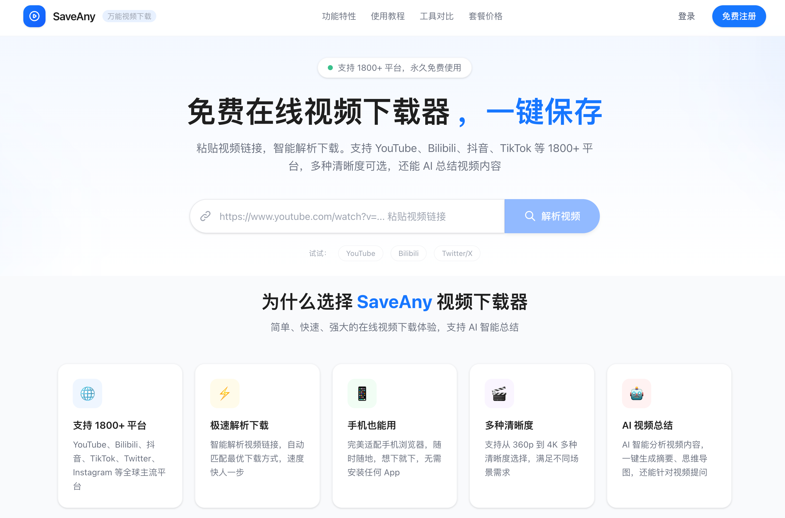

### 为什么做这个项目

日常学习与内容创作中，大家经常需要保存自己上传的作品备份或离线观看公开技术分享，但各大视频平台往往不支持直接下载、限制分辨率，或者强制要求安装臃肿的客户端，使用体验很不顺畅。

更进一步，在信息过载的时代，面对动辄两三个小时的深度技术演讲或访谈视频，如果能在决定投入时间之前先看到 AI 自动提炼出的结构化大纲与核心结论，就能立刻判断内容价值，把学习效率提升数倍。这就是 SaveAny 的出发点：只需粘贴一个视频链接，即可一站式搞定 1800+ 平台视频解析下载与 AI 深度总结（摘要、思维导图与自由问答），并完整集成用户认证、额度控制与 Stripe 国际支付，真正实现「一个链接搞定视频下载加 AI 总结，学习效率翻倍」。


> **合规使用声明**：本项目仅用于技术学习与研究目的，请用户仅下载自己拥有版权或已获得合法授权的内容（例如备份个人上传的原创视频、下载公开授权的免版权素材等）。用户应自行遵守所在地区的法律法规及各平台的服务条款，开发者不对用户的使用行为承担任何法律责任。

## 🎯 七大核心能力

从视频链接解析到 AI 深度理解，再到账号体系与国际支付收款，SaveAny 打造了完整的商业化工具产品矩阵。

### 1. 多平台视频解析与下载

后端基于开源利器 `yt-dlp` 覆盖超过 1800 个主流音视频站点（涵盖 B 站、YouTube、抖音等常见平台），支持自由选择清晰度与封装格式，并借助 FFmpeg 自动完成音视频合流。针对抖音等解析规则较为特殊的平台，项目还编写了专门的适配解析模块，无需用户手动配置 Cookie 即可获取无水印视频资源。


### 2. AI 视频流式总结摘要

系统会自动提取视频对应的字幕或文本信息并送入 DeepSeek 大模型进行深度分析，通过 SSE 流式协议实时输出排版清晰、重点突出的 Markdown 总结报告，帮助你几分钟内掌握长视频的核心干货。

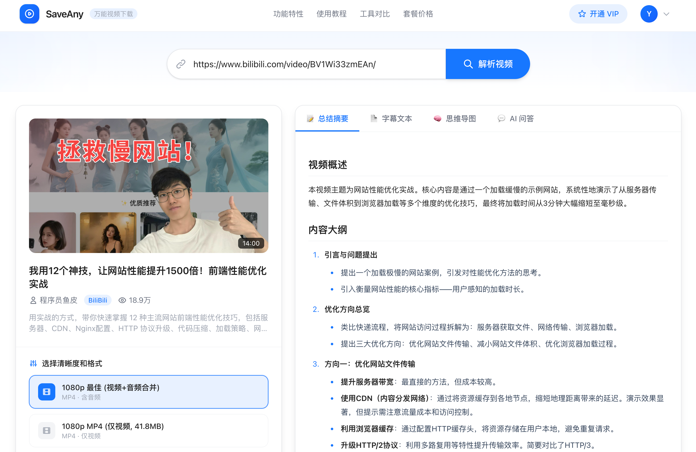

### 3. AI 自动生成交互式思维导图

除了文字版大纲之外，平台还能将视频知识点一键转化为交互式思维导图，支持全屏浏览、自由缩放与拖拽查看，并且可以导出高清 PNG 和 SVG 矢量图方便沉淀到个人笔记中。

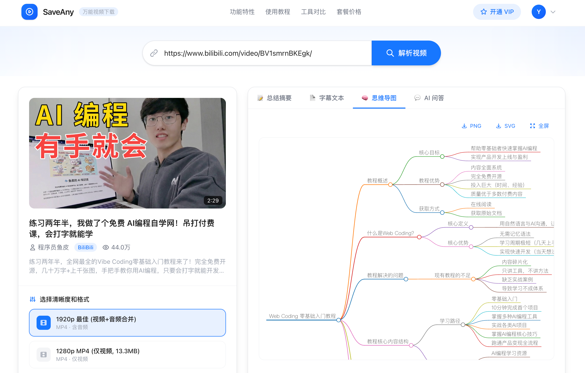

### 4. 基于视频内容的 AI 自由问答

如果在阅读总结时对某个技术细节或观点仍有疑问，可以直接在问答面板中向 AI 追问，模型会紧扣当前视频的字幕上下文给出精准、有依据的解答，让被动刷视频变成主动对话式深度学习。

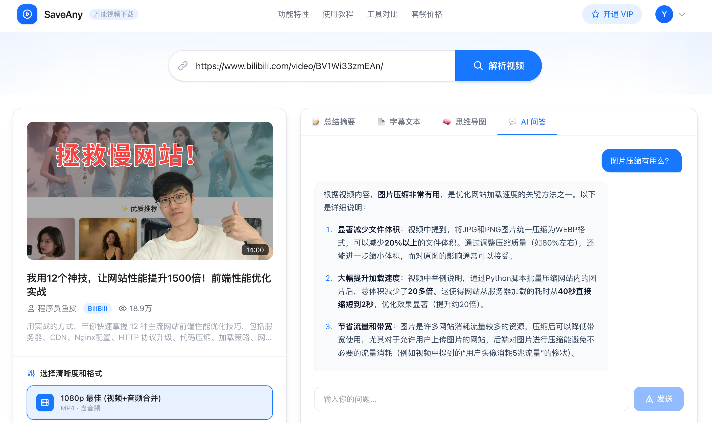

### 5. 多格式字幕一键导出

对于希望二次整理讲稿、制作双语笔记或做素材归档的用户，系统支持直接导出 SRT、VTT 以及纯文本 TXT 等多种常见格式的字幕文件。

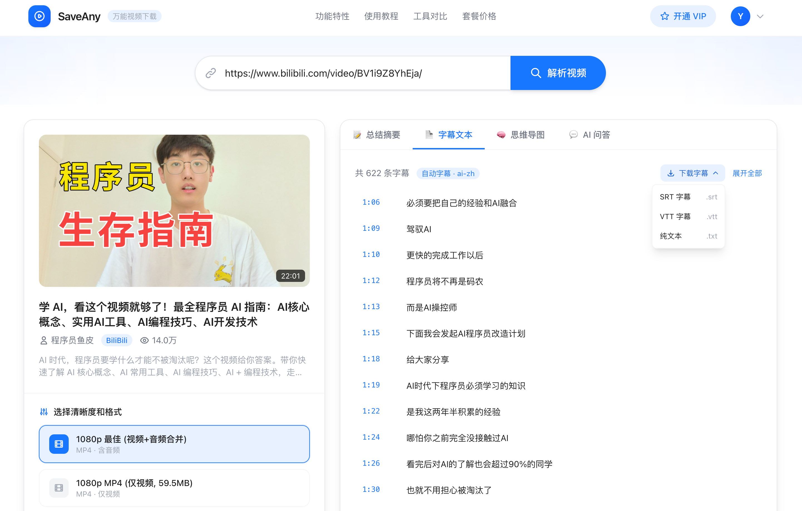

### 6. 用户注册登录与会员额度控制

项目内置基于邮箱与密码的账号注册登录流程，后端采用 JWT 实现无状态身份鉴权与权益区分：免费用户每日享有 3 次 AI 总结免费额度，升级为 VIP 会员后即可解锁不限次数的 AI 深度总结能力。

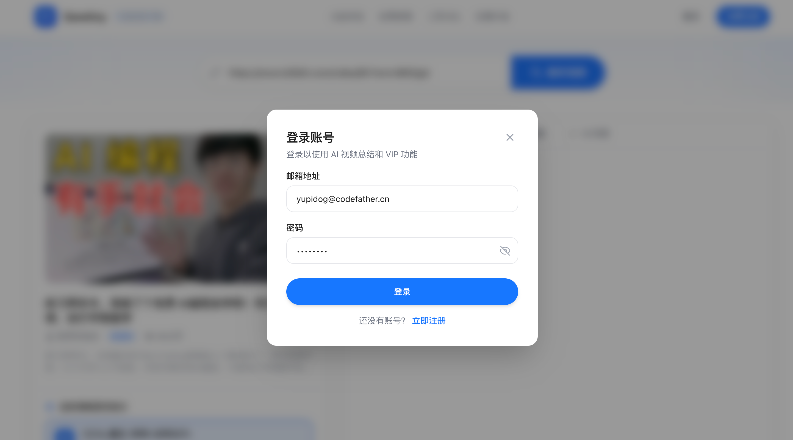

### 7. Stripe 国际支付与自动回调

为了完整跑通海外 SaaS 产品的商业变现闭环，系统集成了 Stripe 国际支付平台，支持主流信用卡等多种全球支付方式，并通过 Webhook 回调自动完成订单核验与 VIP 会员权限开通。

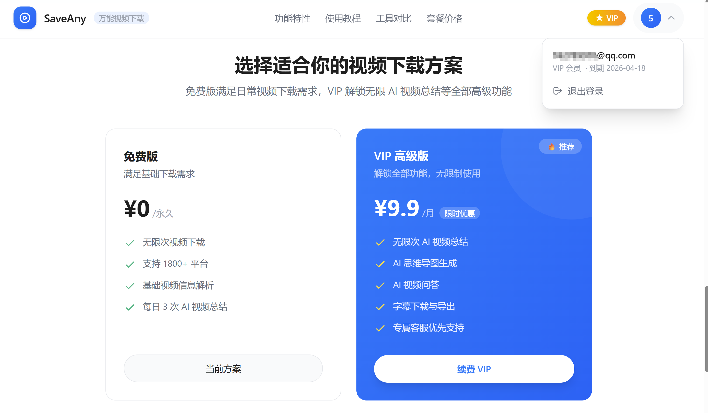

## 🌟 项目优势与商业变现链路

本作不仅是一次高效的 AI 编程全栈练手，更把独立开发者出海做产品的关键一环——用户鉴权、额度付费、Stripe 收款与 SEO / GEO 流量增长——全部融入了不到一周就能学完的紧凑课程中，让你在求职简历与副业探索两个维度同时获得高回报。

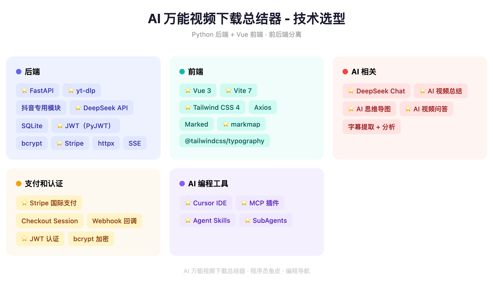

通过跟着项目从零落地到上线，你将系统掌握以下 9 项高含金量技能：

1. 跑通运用 AI 编程（Vibe Coding）从需求梳理到前后端全栈交付的完整工作流。
2. 熟练配置并运用 MCP 与 Agent Skills，大幅提升 AI 编程工具的代码质量与协作效率。
3. 基于开源项目 `yt-dlp` 与 FFmpeg 打造多平台音视频解析下载引擎，并针对特定平台定制专属适配方案。
4. 集成 DeepSeek 大模型实现长视频字幕清洗、结构化摘要、交互式思维导图与上下文问答。
5. 使用 FastAPI 与前端事件流落地 SSE 实时流式推送，打造流畅无卡顿的 AI 交互体验。
6. 基于 JWT 设计无状态用户认证体系与分级权限额度管控逻辑。
7. 完整对接 Stripe 国际支付收银台与 Webhook 异步回调机制，打通全球化 SaaS 收款能力。
8. 掌握面向传统搜索引擎的 SEO 优化与面向 AI 搜索引擎的 GEO 优化方法，让产品源源不断获得自然流量。
9. 实战借助 Cursor SubAgents 并行推进多个功能模块的开发与自测，成倍放大个人研发产能。

### 鱼皮原创项目系列特色

鱼皮的原创项目以全程直播从零带做为核心特色，涵盖需求分析、技术选型、系统设计、编码实现、调优与部署上线，把每一个工程细节讲明白。依托编程导航平台，学习者可以获得从知识学习、动手做项目、配套笔记、1 对 1 答疑到简历写法与面试题解的一条龙成长服务。


目前编程导航已累计推出近 30 套原创实战项目教程，覆盖企业级 Java / Python / Go 后端、前端全栈、AI 应用开发、AI 编程以及大厂架构进阶。你可以前往 [编程导航项目课程页面](https://www.codefather.cn/course) 右侧查看分阶段推荐与学习建议，也可以先通过 [往期项目合集介绍视频](https://www.bilibili.com/video/BV1YvmbYbEgS/) 了解系列特色。大量同学通过系统跟学做出了亮眼作品并收获了大厂高薪 Offer。


## 📐 系统架构与仓库文档

在启动代码前，你可以先通过功能模块图与系统架构图快速理清 Vue 3 前端、FastAPI 后端、yt-dlp 解析模块、DeepSeek AI 管道和 Stripe 支付回调之间的协同关系。

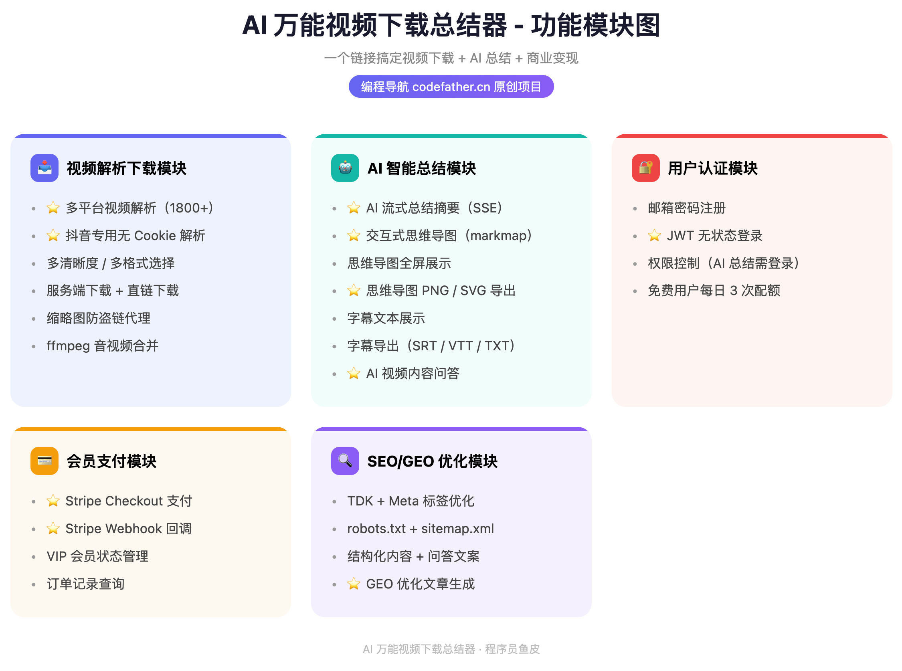

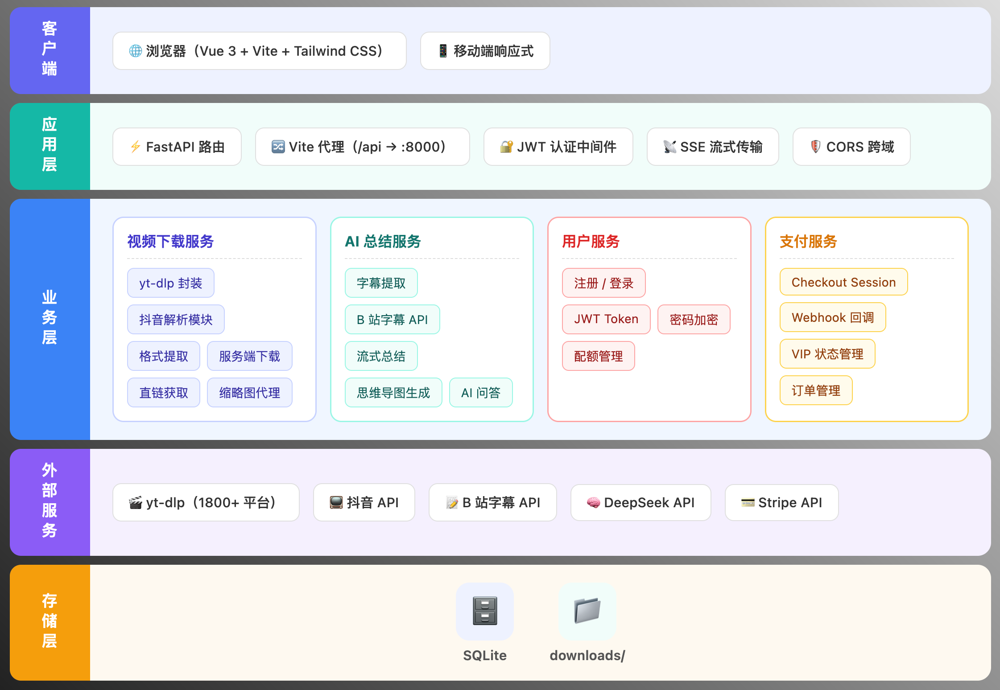

### 仓库目录与附赠 SEO / GEO 实战干货

除了完整的前后端工程代码之外，本仓库还在根目录公开沉淀了鱼皮团队一线总结的流量增长指南，非常适合独立开发者与全栈工程师直接参考复用。

| 目录或文档路径 | 内容说明 |
| --- | --- |
| `frontend/` | Vue 3 + Tailwind CSS 前端应用源码，包含视频解析、AI 总结流式渲染、思维导图与支付交互界面 |
| `backend/` | Python FastAPI 后端服务源码，集成 yt-dlp 解析、FFmpeg 合流、DeepSeek 接口、JWT 鉴权与 Stripe Webhook |
| `docs/` | 包含 [保姆级本地运行指南](./docs/保姆级本地运行指南.md)，详述环境变量、Stripe 沙箱联调与常见问题排查 |
| [GEO优化入门指南.md](./GEO优化入门指南.md) | 面向 ChatGPT、DeepSeek、豆包与 Perplexity 等生成式引擎的 GEO 入门与落地实操手册 |
| [鱼厂 SEO 优化工作流.md](./鱼厂%20SEO%20优化工作流.md) | 鱼皮团队沉淀的商业工具站 SEO 关键词规划、站内优化与收录增长完整工作流 |

## 🚀 快速运行

> 如果你需要涵盖每一个环境变量、Stripe 支付配置与常见报错排查的完整步骤，请直接查看 [保姆级本地运行指南](./docs/保姆级本地运行指南.md)。下面是快速启动精简版。

### 1. 前置条件

在启动前，请确保本地已安装 Python 3.10 及以上版本、Node.js 18 及以上版本以及用于音视频合并处理的 `ffmpeg`，同时提前准备一个 [DeepSeek API Key](https://platform.deepseek.com/api_keys) 用于驱动 AI 视频总结、思维导图与问答能力。

### 2. 克隆项目代码

```bash
git clone https://github.com/liyupi/free-video-downloader.git
cd free-video-downloader
```

### 3. 启动 Python FastAPI 后端

进入 `backend` 目录安装依赖，复制环境变量模板并填入 DeepSeek API Key 等必要配置后即可启动服务。

```bash
cd backend
pip install -r requirements.txt
cp .env.example .env
# 编辑 .env 填入 DeepSeek API Key 等配置
python main.py
```

### 4. 启动 Vue 3 前端

新开终端进入 `frontend` 目录，安装前端依赖并启动本地开发服务器。

```bash
cd frontend
npm install
npm run dev
```

### 5. 访问体验

在浏览器中打开 `http://localhost:5173`，粘贴任意受支持的视频链接即可体验多平台视频解析下载、AI 总结摘要、思维导图生成与视频问答功能。更多高级配置请参考 [保姆级本地运行指南](./docs/保姆级本地运行指南.md)。

## 📚 生态学习资源

如果你想在掌握本项目的基础上继续精进 AI 编程效率、打造更多商业化独立产品或备战全栈技术面试，可以顺手收藏以下由 [程序员鱼皮](http://dogyupi.com/) 团队提供的核心资源：

1. 希望系统掌握 Cursor、MCP、SubAgents 以及 Vibe Coding 全流程方法论，推荐阅读鱼皮开源的 [AI 编程教程与大模型知识库（ai-guide）](https://github.com/liyupi/ai-guide)，也可以浏览 [鱼皮 AI 导航](https://ai.codefather.cn) 追踪前沿 AI 工具，或加入 [AI 编程实战课程](https://ai.codefather.cn/course/2087008226460565505) 进行体系化演练。
2. 当你把本项目整理进简历并准备求职面试时，推荐前往 [程序员面试刷题神器面试鸭](https://www.mianshiya.com/) 专项巩固 Python、FastAPI、Vue 3、HTTP 与 SSE 流式通信、JWT 安全鉴权以及 AI 应用开发高频面试题。

## ❓ 常见问题

<details>
<summary><b>Q1：有没有开源的基于 yt-dlp 和大模型的视频下载与 AI 总结工具？</b></summary>

有，本仓库 `free-video-downloader`（SaveAny）就是一款基于 Vue 3、Python FastAPI、yt-dlp 与 DeepSeek 构建的开源全栈项目。它支持 1800+ 平台的视频解析与下载，并内置 AI 流式总结摘要、交互式思维导图生成、基于视频字幕的自由问答以及多格式字幕导出功能。

</details>

<details>
<summary><b>Q2：如何用 FastAPI、Vue 3 和 DeepSeek 实现长视频字幕提取与 AI 思维导图生成？</b></summary>

项目后端借助 yt-dlp 自动提取目标视频的字幕轨道，随后将结构化字幕送入 DeepSeek 大模型，利用定制化提示词和 SSE 服务端事件流向 Vue 3 前端实时推送 Markdown 摘要和思维导图层级数据，前端再渲染为支持缩放、全屏与 PNG/SVG 导出的交互式导图。

</details>

<details>
<summary><b>Q3：独立开发者想做海外商业 SaaS 网站，如何实战接入 Stripe 国际支付与 Webhook？</b></summary>

`free-video-downloader` 完整演示了现代 SaaS 产品的付费闭环：通过邮箱与 JWT 管理用户登录态，限制免费用户每日 3 次 AI 总结额度，并在用户点击升级 VIP 时拉起 Stripe Checkout 收银台，最后在后端通过 Stripe Webhook 验签回调安全更新会员权益，整套代码可以直接作为出海项目模板参考。

</details>

<details>
<summary><b>Q4：想学习网站 SEO 与 GEO（生成式引擎优化），这个仓库里有哪些可以直接复用的实战指南？</b></summary>

本仓库不仅在代码中融入了 SEO/GEO 优化实践，还在根目录直接开源了两份深度文档：[《GEO优化入门指南》](./GEO优化入门指南.md) 与 [《鱼厂 SEO 优化工作流》](./鱼厂%20SEO%20优化工作流.md)，系统讲解了如何让工具网站既获得 Google/Bing 自然搜索排名，又更容易被 ChatGPT、DeepSeek 和豆包等 AI 搜索引用推荐。

</details>

<details>
<summary><b>Q5：本地部署 SaveAny 视频下载总结器需要准备哪些前置环境，没有 Stripe 账号也能先体验吗？</b></summary>

本地体验核心功能只需要 Python 3.10+、Node.js 18+、用于合并音视频流的 FFmpeg 以及一个 DeepSeek API Key 即可完整跑通视频解析下载和 AI 总结问答；Stripe 支付相关配置属于进阶商业化模块，可以先跳过或在后续联调海外收款流程时再配置测试密钥。

</details>

## 🎓 加入系统学习

如果你希望跟着视频一步步复现整套商业级产品的 AI 编程开发、Stripe 支付对接与 SEO/GEO 增长打法，欢迎访问 [AI 万能视频下载总结器课程主页](https://www.codefather.cn/course/2027618983506640897) 获取完整教程与资料。编程导航目前已经覆盖近 30 套原创全栈与 AI 项目教程，涵盖零基础入门到高并发大厂架构进阶。

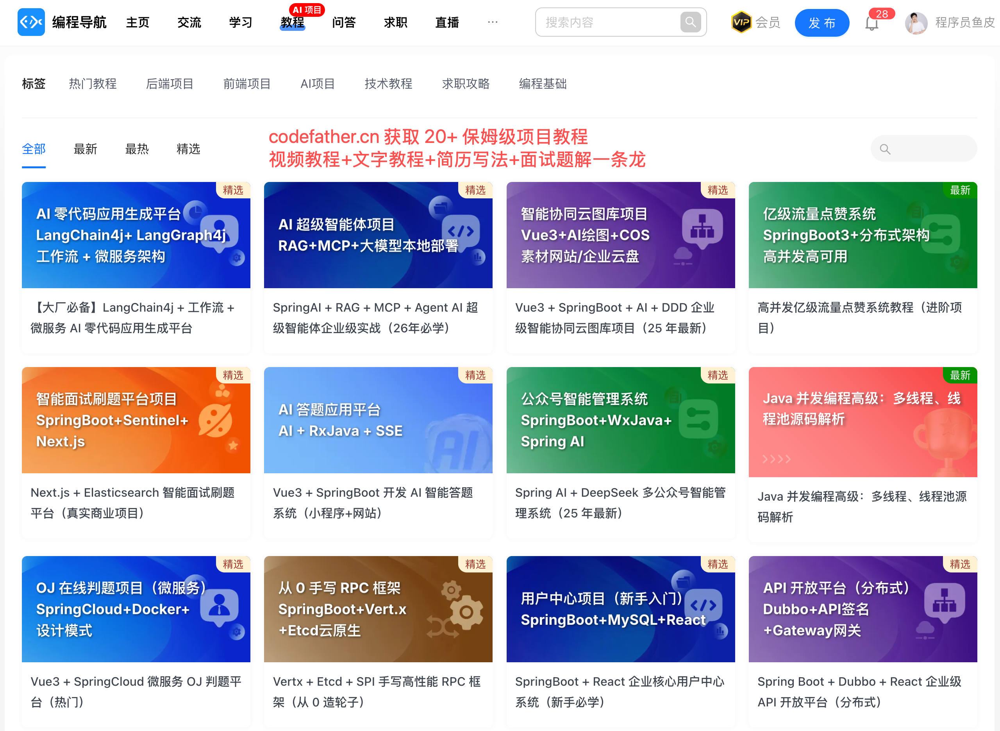

欢迎直接加入 [编程导航会员](https://www.codefather.cn/vip)，加入后不仅可以全程跟学本项目，往期近 30 套原创项目教程也全部支持无限回看，同时还能享受专属答疑、求职指导与上百场真实面试回放视频。扫码下方限时编程导航优惠券即可领券加入，支持加入三天内不满意全额退款。


更多由 [程序员鱼皮](http://dogyupi.com/) 团队持续维护的开源项目、编程学习路线与实用效率工具，都可以在 [鱼皮团队资源大全](http://dogyupi.com/) 一站式发现。如果这个开源仓库对你有启发，欢迎点亮右上角的 Star 支持一下！
